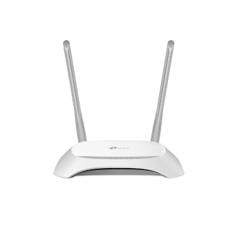

<div align="center">

# 📡 tpwrctl

**A command-line remote control for the TP-Link TL-WR850N — a router that laughs at the idea of SSH.**




</div>

---

## 🤔 Why does this exist?

This little N300 router has **no SSH**, a web UI nobody wants to click through, and a telnet
console that is *not even a real shell*. So `tpwrctl` does the clicking for you: it logs
into the router's web interface, speaks its native (undocumented) `/cgi` protocol, and gives
you clean, scriptable commands. It can also drive the hidden telnet CLI when that's the only
place a setting lives.

> 🔒 Built for **your own** router. It's an N300 running embedded Linux from **2019** — be nice to it.

## 🚀 Quick start

```bash
tpwrctl status        # everything at a glance
tpwrctl devices       # who's on my network?
tpwrctl audit         # am I owned?
```

First run will ask for the admin password (or save it once with `tpwrctl config`).
Credentials resolve from `--password` → `$ROUTER_PASS` → `~/.config/tpwrctl/config.json` → prompt.

## 🧰 Commands

### Over the web UI (the main path — always available)
| Command | What it does |
|---|---|
| `status` | Model, firmware, WAN, public IP, CPU, online devices — one screen |
| `devices [--online]` | Every device: name, IP, MAC, wired/Wi-Fi, signal |
| `wifi` | Show AP config (SSID, security, **password**) + clients |
| `wifi --ssid/--password/--bandwidth/--radio` | **Change Wi-Fi** (confirms first; `--dry-run` to preview) |
| `wan` | Internet connection details (IP, DNS, NAT, firewall) |
| `speed [--interval N]` | Live per-client Wi-Fi throughput |
| `cpu` | CPU usage + approximate uptime |
| `firmware` | Firmware version + update advice |
| `audit` | 🔎 Security audit — port exposure + config findings |
| `reboot [-y]` | Reboot (asks first; `-y` to skip) |
| `oids` | 📖 Catalog of web-API objects you can `get`/`set` |
| `get <OID> [attrs] [--gl] [--stack S] [--json]` | **General read** — any object, friendly or JSON |
| `set <OID> attr=val ... [--stack S]` | **General write** — change any setting |
| `config --password ...` | Save host + password (mode 600) |

**Change Wi-Fi over the web** (the web-UI alternative to `telnet wlctl set`):
```bash
tpwrctl wifi --dry-run --ssid MyNet --password 'secret123'   # preview — sends nothing
tpwrctl wifi --password 'secret123'                          # set the key (asks to confirm)
tpwrctl wifi --bandwidth 20M                                 # Auto | 20M | 40M
tpwrctl wifi --radio off                                     # turn the radio off/on
```
> ⚠️ Changing Wi-Fi restarts the radio — connected clients drop for a few seconds.

### Over the telnet CLI (for the few settings only it exposes)
| Command | What it does |
|---|---|
| `telnet <cmd...>` | Run a CLI command (quotes optional), output nicely formatted |
| `telnet --list` | 📖 Telnet CLI command reference |
| `telnet --raw <cmd...>` | Show the router's unprocessed text |
| `telnet -y dev reset` | Destructive commands are guarded (`-y` required) |

```bash
tpwrctl telnet dev serial show     # note: 'dev serial' alone isn't complete
tpwrctl telnet wlctl show
```

**Two general tools, two transports:** `get`/`set` (+ `oids`) for the web API, and
`telnet` (+ `telnet --list`) for the CLI. Use `oids` / `telnet --list` to discover what's available.

## ✨ Looks like

```
$ tpwrctl status
Model        : TL-WR850N  (hw TL-WR850N v3 00000003)
Firmware     : 3.16.0 0.9.1 v6040.0 Build 191011 Rel.63822n   [built 2019-10-11]
WAN          : Connected  via IP_Routed
Public IP    : 203.0.113.x
CPU usage    : 3%
Devices      : 5 online  (8 known)
   MacBookPro             192.168.1.x     aa:bb:cc:dd:ee:ff Wi-Fi   -52dBm 144Mbps 11n
   ...
```

## 🧬 How it works

No SSH exists, so everything rides the **web admin interface (port 80)**:

- **Login** (reverse-engineered from the router's own JS): salt `ss` from `POST /cgi/getParm`,
  then `POST /cgi/login?UserName=MD5(ss+"admin"+ss)&Passwd=MD5(ss+base64(pw)+ss)`. Success
  yields a `JSESSIONID` cookie + a page token.
- **Data**: `POST /cgi?<act>` with header `TokenID: <token>` and a body of
  `[OID#stack#pstack]<idx>,<n>` lines (`1`=GET, `2`=SET, `5`=list, `7`=reboot). Replies come
  back as `key=value`, parsed into dicts.
- **Telnet** is a bonus transport: a proprietary `TP-Link(conf)#` command tree (not a shell —
  no `cat`/`ls`), one session at a time, plaintext.

## 🛡️ Security notes (from `tpwrctl audit`)

This firmware is old and the box is chatty. Headline findings: 2019 firmware with WR840N-family
CVEs, TR-069/CWMP listening on `:7547`, UPnP on, telnet open. Remote web management is **off**
(good). Run `tpwrctl audit` for the live list. You can harden with `set` (e.g.
`set UPNP_CFG enable=0`).

## ⚠️ Caveats
- The web UI allows **one session at a time** — logging in here may bump a browser session.
- 5 wrong passwords = ~10-minute lockout. Don't brute-force your own router. 🙂
- `reboot`, `set`, and `telnet` write operations change device state — use with intent.
- Telnet is plaintext; `wlctl show` prints your Wi-Fi key. Treat the LAN accordingly.

---

<div align="center">
<sub>Made with ☕ and packet captures · talks to a MIPS box running Linux 2.6-ish · no routers were harmed</sub>
</div>
